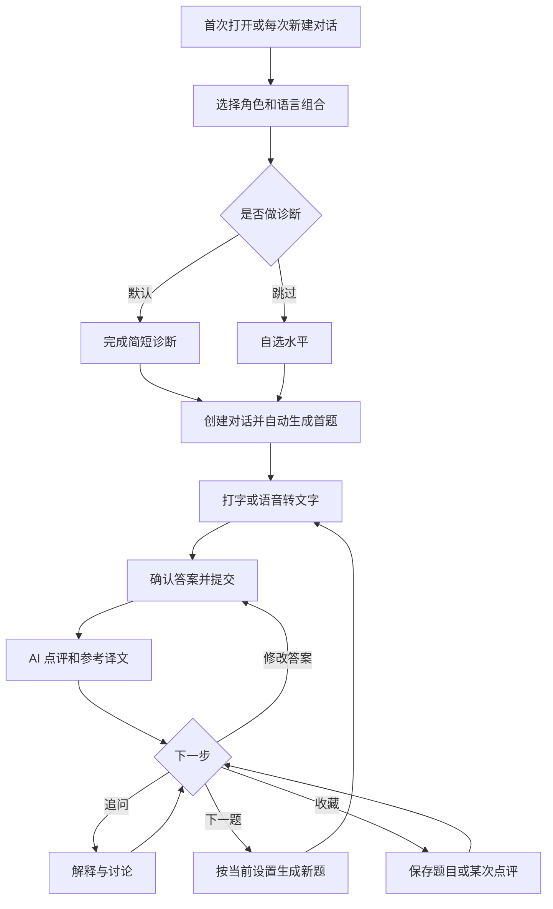
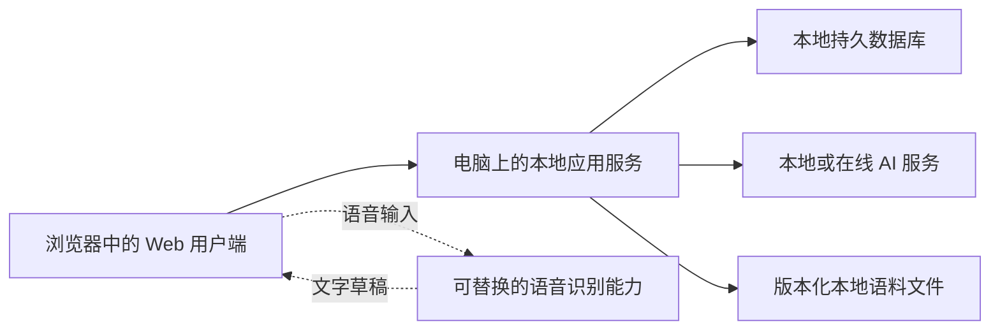

# AI 语言翻译练习 Web App 产品需求文档（PRD）

> 文档版本：1.2
> 首版范围：本地验证版 MVP
> 日期：2026-10-14
> 产品名称：暂用功能名称，不代表最终品牌
> 需求依据：本次需求访谈及用户对整体需求的明确确认

版本 1.2 变更：新增官方渠道本地分级语料库、本地优先出题、来源署名、分区与全局家族去重；覆盖不足时 AI 补充，等级为待校准估计。编写规范见 [语料库编写与维护规范](docs/CORPUS_GUIDE.md)，实际覆盖见 [发布报告](corpus/REPORT.md)。

版本 1.1 变更：每次新建对话均询问是否进行简短诊断，已有目标语言水平档案也不省略选择。默认诊断；用户显式跳过后自选水平。

## 1. 文档约定

- **已确认需求**：访谈中确定的产品方向与功能范围，构成首版基线。
- **建议默认值**：为便于实现和验证而补充的题数、参数、权重、交互细则，可在验证中调整，不代表用户已逐项确认。
- **后续扩展**：首版保持合理的数据与模块边界，不要求提前实现后续功能。
- 本文描述产品行为与验收条件，不锁定开发框架、AI 厂商、模型或云服务商。具体技术选型应服务于首版本地验证目标。

## 2. 产品定位与问题

### 2.1 一句话定位

通过“看题—主动翻译—AI 点评—追问修改—复习”的练习循环，帮助有一定语言基础的学习者把“看得懂”转化为“写得出、说得出”。

### 2.2 要解决的问题

1. 用户能理解部分外语内容，但主动表达时会卡住，缺少持续输出的机会。
2. 用户写出答案后，不容易判断意思是否准确、表达是否自然，以及具体应如何修改。
3. 自己寻找符合水平的练习题和参考表达，需要额外精力。
4. 同一用户有不同语言、角色和练习目的，需要保存多个独立的练习空间。
5. 看过点评后，容易丢失值得再次练习的题目和解释。

### 2.3 首版用户

优先服务产品发起者本人，再验证对类似学习者的适用性。核心用户已具备一定目标语言基础，希望改善日常、工作、考试或海外生活中的表达。

“小学生、初中生、高中生”等首先是出题内容与学习阶段标签。首版不包含学校管理、教师端或面向未成年人的公开运营体系。

## 3. 产品目标与验证标准

### 3.1 已确认的成功标准

- 题目难度与用户水平相匹配，允许一定浮动。
- AI 点评可信，能解释具体问题，并接受合理的不同译法。
- 用户能根据点评改善表达。
- 用户愿意持续使用，而非仅尝试一次。

### 3.2 建议的本地验证方式

以下指标用于验证产品价值，不作为已证明的学习效果，也不是对模型准确率的承诺。

| 验证方向 | 建议方法 | 建议观察目标 |
|---|---|---|
| 练习意愿 | 连续 7 天记录实际使用 | 至少主动练习 5 次，无强制提醒 |
| 难度匹配 | 对至少 30 道题标记“太易／合适／太难” | 至少 70% 被认为合适，检查连续过难情况 |
| 点评可信度 | 对三种目标语言分别抽样，由具备相应语言能力的人核查 | 明显误判逐条记录并修正；不能只让同一 AI 自评 |
| 当题改进 | 对比首次作答与修改后作答 | 用户能说明主要修改原因，修改解决原有问题 |
| 能力迁移 | 隔日用未见过、考查相同知识点的新题验证 | 观察能否独立运用，不把照抄参考译文视为掌握 |
| 产品可靠性 | 重启、切换对话、备份恢复等验收 | 学习数据完整，失败可恢复 |

若暂时无法获得某种语言的可靠人工核查，只能记录主观体验，不能宣称该语言的点评质量已验证。

## 4. 版本范围

### 4.1 首版必须包含

| 模块 | 范围 |
|---|---|
| 运行形态 | 适配手机与电脑浏览器的 Web App，本地单用户运行 |
| 语言 | 中文、英语、法语；支持六个不同语言之间的翻译方向 |
| 界面国际化 | 三种界面语言；默认跟随设备系统，可独立修改 |
| 角色 | 学习阶段、考试、生活等角色选择 |
| 水平诊断 | 每次新建均询问，默认诊断，也可跳过并自选水平；按目标语言保存 |
| 多对话 | 新建、切换、恢复独立练习空间 |
| 出题 | 默认随机练习；本地语料优先，AI 补充；场景可选、可切换、可取消 |
| 输入 | 打字、语音转文字、转写确认与修改 |
| 点评 | 整体判断、具体修改、参考译文、评分 |
| 互动 | 多轮追问、多次修改、再次点评、主动下一题 |
| 难度 | 根据多道题的首次作答缓慢调整；支持手动调整与固定 |
| 复习 | 收藏题目、收藏点评、重新作答、查看前后记录 |
| 数据 | 本地持久保存、导出／导入备份 |
| AI 接入 | 本地服务端调用本地千问或可配置在线 AI，明确失败状态 |

### 4.2 首版不包含

- 账号注册、登录、多用户、云同步及公网部署。
- 原始语音的发音、重音、流利度、停顿评价。
- 官方考试模拟、官方考试分数或语言等级认证。
- 每日学习计划、连续打卡、提醒与推送。
- 教师端、班级、社交、排行榜、支付与订阅。
- 完整课程体系、听力训练、参考译文朗读。
- 全部语言扩展、复杂间隔复习算法；浏览器语音不保证离线。已安装本地 AI 后文字练习可离线。
- 自动收集所有错误并形成独立的错题系统；首版以用户主动收藏为复习入口。

## 5. 核心概念与设置归属

### 5.1 概念定义

| 概念 | 定义与示例 |
|---|---|
| 界面语言 | 按钮、菜单、设置、错误提示所用语言 |
| 出题语言 | 原始待翻译句子的语言；默认也是 AI 点评和解释的语言 |
| 目标语言 | 用户需要输出的译文语言；也是参考译文的语言 |
| 角色 | 学习背景或使用类型，例如高中生、雅思备考、海外生活 |
| 水平 | 某种目标语言下当前估计的主动表达能力，不等同于角色或认证等级 |
| 场景 | 可选的具体练习目的，例如餐厅点餐、工作邮件、与房东沟通 |
| 对话 | 保存语言、角色、场景、难度和练习记录的独立空间 |
| 题目 | 一条待翻译句子及必要上下文、生成时设置快照 |
| 作答尝试 | 对题目的一次正式提交；修改后再次提交会形成新尝试 |
| 追问 | 围绕题目或点评提出的问题，不自动视为新的翻译答案 |

### 5.2 语言规则

支持：中文→英语、中文→法语、英语→中文、英语→法语、法语→中文、法语→英语。

- 出题语言与目标语言不可相同。
- 界面语言独立于翻译方向。中文界面下可以练习英语→法语。
- 参考译文使用目标语言，解释与点评默认使用出题语言。
- 三种语言都必须覆盖核心界面和错误提示，不能只翻译菜单。
- **建议默认值**：系统语言匹配中文、英语或法语；其他系统语言回退英语。用户主动选择后保持其选择，不被后续系统变化覆盖。

### 5.3 设置继承与隔离

| 设置 | 保存位置 | 修改影响 |
|---|---|---|
| 界面语言 | 全局 | 立即影响全部页面，不改写已有学习内容 |
| 默认角色、默认语言组合 | 全局默认 | 供新对话继承，不覆盖已有对话 |
| 各目标语言的基准水平 | 语言档案 | 供新对话自选水平预填；每次仍询问诊断或跳过，可重新诊断或手动调整 |
| 对话角色、语言、场景、难度模式 | 对话 | 影响该对话之后生成的题目 |
| 题目与作答的实际设置 | 每题快照 | 保留生成与评分时的上下文，后续设置变化不改写历史 |

**建议默认规则**：自动调难只更新当前对话的练习难度，不在多个场景间自动改写全局基准。更新全局基准通过重新诊断或显式调整完成，防止熟悉某个场景被误认为整体水平提升。

## 6. 用户主流程

已有用户打开应用时恢复上次对话及进度，不重新询问诊断。每次新建对话继承默认角色与语言，默认不设场景，均展示“简短诊断”和“跳过，自选水平”，默认选中简短诊断。已有目标语言档案仅预填自选水平；选择诊断则进入新诊断，显式跳过则按用户确认的水平生成首题。

恢复已有对话、刷新页面和在对话间切换，不应自动生成新题或触发新的 AI 调用。

## 7. 页面与交互

### 7.1 首次引导、新建对话与诊断

- 选择界面语言、默认角色、出题语言、目标语言。
- 每次新建对话均说明默认将做简短诊断，并提供“跳过，自选水平”；已有档案或切换语言组合时不得隐藏这两个选项。
- 未配置 AI 服务时，指引完成本地配置；配置缺失不产生空白诊断页。
- 诊断结束显示初始水平、简短理由及“可调整”入口。
- 不强制选择场景。

### 7.2 主练习页

桌面端建议布局：侧栏显示对话列表；中央为题目、作答和追问记录；顶部显示当前角色、语言组合、场景、难度；底部为输入与操作区。

手机端建议布局：侧栏收为抽屉；当前设置可折叠；题目与输入优先显示，录音、提交和下一题可直接操作。

主要操作：

- 新建／切换对话。
- 查看或修改当前角色、翻译方向、场景与难度。
- 输入答案、录音、修改转写结果、提交翻译。
- 追问、修改答案、重新点评。
- 收藏题目、收藏某次点评。
- 出题／下一题。

**建议交互细则**：输入区区分“提交翻译”和“发送追问”，不依赖 AI 猜测消息意图；同一题的多次作答以明确的版本展示。允许重命名对话，默认标题由角色、语言组合和场景生成。

### 7.3 收藏与复习页

- 按“题目”“点评”区分收藏类型，可按语言组合、对话筛选。
- 题目收藏展示原句、必要上下文及练习入口。
- 点评收藏保存对应答案、完整点评和题目关联，支持定位原记录。
- 进入重新作答时默认隐藏旧答案与参考译文，提交后再展示对比。
- 取消收藏只移除收藏关系，不删除原练习记录。

### 7.4 设置页

- 界面语言、默认角色、默认语言组合。
- 各目标语言的基准水平、重新诊断入口。
- AI 服务配置状态与连接测试；密钥不返回给浏览器。
- 数据导出、导入及结果说明。
- 当前数据位置、本地运行说明和 AI 联网说明。

## 8. 详细功能需求

### FR-01 角色选择

已确认：通过角色帮助匹配内容和初始难度背景，新对话继承默认角色，允许单独调整。

**建议首版角色**：小学生、初中生、高中生、雅思备考、GRE 备考、海外生活、日常交流、工作交流、自主学习。

- 角色决定话题、语域和知识点倾向；实际水平决定句法与表达复杂度。
- 不把雅思、GRE 等角色直接映射为唯一能力等级。
- 例如“高中生＋较高水平”仍采用适龄话题，但可提高表达复杂度。
- 考试角色只表示训练方向；中文或法语作为目标语言时可学习相关话题与语域，但不标称为对应英语考试的有效备考或官方评分。

验收：同一角色下，不同水平生成的题目有可辨别的复杂度差异；同一水平下，不同角色的话题和表达重点可辨别。

### FR-02 默认诊断与跳过

- 每次新建对话均询问是否进行简短诊断，默认选择诊断；与出题语言、目标语言及是否已有水平档案无关。
- 用户可显式选择“跳过，自选水平”，选择有具体描述的水平后开始。
- 已有目标语言档案时，自选水平默认填入档案水平，可调整；没有档案时采用建议默认 L2。档案不能自动替用户跳过诊断，也不能隐藏选择。
- 每次重新打开新建表单时默认选中诊断，不沿用上次的跳过选择。切换目标语言时两个选项始终可见。
- 跳过时确认的水平应用于当前新对话；已有全局档案不被自动覆盖。若没有档案，可保存首次自选水平。
- 打开或恢复已有对话不触发新诊断；修改已有对话目标语言的规则仍按 FR-04 执行。
- 允许随时重新诊断，完成后保留旧结果，并由用户选择是否更新全局基准；当前对话可采用新水平。
- 诊断题必须要求主动输出，不能只靠选择题推断表达能力。
- 诊断失败或中途退出时保留已完成答案，可继续或改为自选水平。

**建议默认值**：5 道短翻译题，按角色与表现逐步调整复杂度；诊断期间暂不展示完整参考答案，完成后统一展示诊断结果及题目点评。诊断结果为练习难度估计，不换算官方考试分数或认证等级。

**建议内部水平**：L1 基础短句、L2 日常简单表达、L3 多分句与常见抽象表达、L4 较复杂观点与语域切换、L5 精细语义与较复杂表达。界面以描述为主，避免仅展示不易理解的编号。

验收：在三种目标语言有／无档案时反复新建对话，均出现诊断与跳过选项且默认诊断；切换语言组合不隐藏选项；两条路径都能进入首题，跳过时可沿用或修改预填水平，已有档案不自动覆盖；三种目标语言拥有独立结果；诊断题不计入正式练习的难度调整窗口。

### FR-03 多对话与恢复

- 每个对话独立保存角色、语言组合、场景、难度状态、题目、答案、点评、追问、草稿和当前进度。
- 可在多个对话之间自由切换，切换后恢复原内容。
- 对话 A 的设置、题目和异步返回结果不得写入对话 B。
- 进入已有对话延续原目的；场景为空也是有效且可保存的状态。
- 切换对话不阻塞已提交的 AI 请求，结果应落入发起请求的对话与题目。

验收：创建不同语言和场景的两个对话，交替练习、刷新和重启服务后，设置与记录均保持独立。

### FR-04 自动首题、随机出题与场景

- 新对话准备就绪后自动生成首题，无需强制选场景。
- 随机题符合角色、水平与语言方向，每题以一句话为主体；必要时使用自足的短语段或短对话，保留完整逻辑，不截断官方原句。必要上下文不泄露答案。
- 场景既可从预设选择，也可自由输入，并可随时取消。
- 预设场景建议包括日常生活、餐饮购物、旅行出行、学习校园、工作沟通、海外生活、观点表达。
- 场景切换仅影响后续题目，不把当前题目悄悄替换。
- 场景不适合当前水平时，应简化表达要求，仍围绕该场景出题。
- 用户主动点击下一题后才继续生成；每次只新增一道题。
- 未作答也可跳过当前题，跳过不计低分或错误。
- **建议默认值**：检查最近 20 道题，避免原句完全重复，并尽量分散知识点和话题。知识点可重复，原句不应机械复用。

验收：默认不选场景可连续练习；设置、切换、取消场景后，下一题反映相应变化；刷新不重复出题。

### FR-04A 本地分级语料与来源

- 按 `docs/CORPUS_GUIDE.md` 执行官方采集、双方许可／署名核验、清洗、去重与家族分组、内容编选、方向分级、分区和可复现构建。
- 首批采用 Tatoeba 官方 API 的中英、中法、英法直连句对；保留响应快照、实际 URL／时间／SHA-256、双方句子 ID／作者／许可／链接。官方渠道不等于权威语言考试认证。
- 本地库覆盖六个方向与 L1–L5；每个方向分别标级并保存理由，等级为 provisional，不宣称 CEFR 等级认证。每条保存参考、知识点、含义约束和真实审核状态。
- 优先随机选择方向、等级、角色、场景及用途都匹配的任务。自定义场景仅按明确别名精确匹配；无匹配、场景或角色覆盖不足、已见题用尽时走既有 AI 出题并记录回退原因，不借用错误方向或等级充数。
- practice、diagnostic、evaluation 按完整语义家族分区，反向题及识别到的近义改写不跨区；evaluation 不用于运行时出题。全用户跨对话排除已见本地家族，并发取题也不得重复占用同一家族。
- 题目展示“本地语料（试用）”或“AI 生成”。答题前服务端不返回参考、含义约束和可打开译文的来源链接；普通题成功点评后、诊断全部完成后展示双方署名、来源和许可；复习首次作答仍隐藏来源链接。
- 点评可参考语料含义约束和译法，但必须独立对照可见原句，接受合理变体，不能增加原句没有的评分要求。
- 本地取题不需要 AI；点评、追问、诊断总结与回退出题仍需 AI。本地语料文件随源码分发，不放入被忽略的个人学习目录；已保存题目保留快照，更新库不改写历史。
- 独立人工审核使用单独账本，绑定任务当前内容指纹并记录真实审核者、能力范围、日期、五项检查与结论；拒绝或需修改的在库条目阻止发布，内容变更后旧通过记录失效。导出逐题清单支持实际审核；程序不能验证审核者身份，不得把 AI 记录冒充人审。
- 自动筛选／AI 编选、独立人工审核、用户验收声明、学习者校准分别记录。2026-10-15 用户要求全部按人工检查通过计算，当前300题按该验收口径通过，使用单独的 releaseAcceptance 保存原话、日期与内容指纹；独立逐题审核数量与用户要求视为通过数量分开统计。保留真实审核历史，不补造审核者或逐项检查记录；等级仍待真人校准，不能宣称学习效果已验证。

验收：六方向×五等级三个分区都有覆盖；来源可逐项回溯、双方许可在白名单、编选文本与官方快照一致；构建离线且结果一致。验证本地命中无模型生成调用、精确回退、诊断隔离、全局去重、并发预留、答案与来源链接不提前泄露，以及旧记录／备份兼容。

### FR-05 语言或角色变更

- 用户可在当前对话修改出题语言、目标语言和角色。
- 当前题目始终使用生成时的设置快照；修改设置后，以清楚提示说明“从下一题生效”。
- 历史答案、参考译文和点评不重新翻译、不重新评分。
- 新目标语言没有水平档案时，先诊断或自选水平，再生成新题。
- 改变目标语言或角色后重置当前对话的调难观察窗口，避免混用旧背景下的成绩；已有记录保留。
- 交换翻译方向时，一次完成两种语言的交换，不出现中间的同语状态。

验收：中文→英语的旧题在切换为英语→法语后，仍按中文→英语点评；下一题按新设置生成。

### FR-06 文字与语音输入

- 用户可直接编辑和提交目标语言答案。
- 语音识别以当前题目的目标语言为识别语言，支持中文、英语、法语。
- 显示录音中、转写中、完成、失败等状态，支持停止与取消。
- 转写结果进入可编辑草稿，用户确认后才作为答案提交。
- 首版只按最终文字点评，不分析发音、口音、流利度或停顿。
- 麦克风不可用、权限拒绝、浏览器不支持或识别失败时，保留草稿并提供文字输入。
- 取消录音不删除用户之前输入的文字。
- **建议默认值**：每次录音上限 60 秒；有文字时将转写追加到草稿，允许撤销本次追加。原始音频仅临时处理，不进入学习记录或备份。

验收：三种目标语言均有可验证的转写路径；失败降级不丢字；未确认的转写不会自动提交。某浏览器缺少原生能力时，应通过可替换识别服务补足或明确限定支持环境，不能将按钮存在视为功能完成。

### FR-07 AI 点评与评分

每次正式作答后提供四部分：

1. **整体判断**：语义是否准确、表达是否成立与自然，指出值得保留的表达。
2. **具体修改**：引用对应片段，解释问题并给出改法；区分错误与可选润色。
3. **参考译文**：至少一个准确自然版本；有教学价值时补充另一种口语或正式表达。
4. **评分**：总体分数及可解释的维度结果，不以参考译文的字面一致度打分。

必须遵守：

- 以原句含义和明确背景判断，允许多种正确表达。
- 区分语义错误、语法错误、词汇搭配、语域差异与风格偏好。
- 不将“可以更优雅”描述为“原答案错误”。
- 原句有歧义时说明合理理解；不能用用户未见的背景惩罚其答案。
- 识别到非目标语言作答或无关文本时，提示重新作答，不把它当有效语言能力样本。
- 空白答案禁止提交；答案不完整但确实尝试翻译时，正常指出遗漏并评分。
- 没有明显问题时允许明确给出“无需修改”，不为凑内容制造错误。
- 点评与分数明显矛盾、结构缺失或超出合法范围时，不发布不完整评分，提供重试。
- AI 点评属于学习建议；考试角色不输出冒充官方的考试分数。

**建议评分默认值**：总分 0–100；语义准确 40%、语法 25%、词汇与搭配 20%、自然度与语域 15%。各维度先用相同量纲评分，再按权重计算总分。正确但与参考不同的译法可获得满分；必要可选润色不应造成明显扣分。

**建议展示原则**：默认突出最重要的 1–3 个问题，完整问题清单可展开；避免长篇点评掩盖主要修改点。

验收：准备同义改写、地区变体、不同礼貌程度、语义反转、遗漏否定、错误时态等样例，验证能区分正确变体和真实错误，并确保评分与解释一致。

### FR-08 追问、修改与下一题

- 用户可围绕某次点评追问词汇、语法、表达差异，也可请求更多例句。
- 追问回答应关联当前题目和对应点评，不自动生成新题或重计分。
- 点击“修改答案”后编辑副本；再次提交创建新作答与新点评，不覆盖旧记录。
- 历次作答和点评可回看、对比，并明确标注首次、修改后或复习作答。
- 点击下一题结束当前活动题并创建新题，旧题仍可从历史定位并重新练习。
- **建议默认规则**：未提交草稿自动保存；提交／点评进行中暂时禁用同题的下一题，用户仍可切换对话。请求失败后允许重试或跳过。

验收：同一题能完成“首次作答→追问→修改→再次点评→下一题”，所有版本保留；追问和重复提交不被误算为多道新题。

### FR-09 自动调难与手动控制

已确认：默认自动，根据近期多道题的首次作答缓慢调整；支持手动调难、调易和固定难度。

参与调难的样本：

- 正常练习中新题的首次正式作答，并且点评成功、有效。
- 已查看该题参考答案后才首次提交、复习、修改作答、诊断题、跳过、追问、失败请求均不参与。
- 同一道题最多提供一个样本，不把网络重试算成新的表现。

**建议首版策略**：

| 项目 | 建议默认值 |
|---|---|
| 观察窗口 | 当前对话最近 5 道符合条件的新题 |
| 提高条件 | 平均分 ≥85，且最低分 ≥70 |
| 降低条件 | 平均分 <60 |
| 单次变化 | 最多一个内部水平，限制在有效上下界 |
| 调整后 | 清空观察窗口，至少再积累 5 道题后调整 |
| 题目浮动 | 自动模式约 70% 当前水平、各 15% 相邻较易／较难水平；边界重分配 |
| 固定模式 | 不自动改变基准、不跨水平浮动；同级题可有自然复杂度差异 |
| 手动操作 | 可调整当前基准；是否固定由用户独立选择；调整后重置观察窗口 |

- 自动调整需显示简短原因，例如“最近几题完成较好，后续稍微提高难度”。
- 题目难度是多方面约束，至少包括句法、词汇常见度、语义抽象程度、语域和长度，不能仅以字数定义。
- 同一目标语言在不同出题语言下可能表现不同；首版记录语言组合和题目难度，供复盘，不宣称小样本可精确测量语言能力。

验收：修改后的高分不触发升级；单次低分不直接降级；固定模式下连续高低分均不自动改变难度。

### FR-10 收藏与复习

- 支持收藏一道题，也支持收藏某次 AI 点评；两类对象不能混为一条无来源文本。
- 同一对象重复收藏不产生重复项。
- 从收藏题目进入复习，保留原题和必要背景，默认隐藏旧答案。
- 复习作答形成单独记录；完成后可对比首次、历次修改及本次答案与点评。
- 复习使用原题设置快照，避免当前语言或角色变更改变题意。
- 收藏点评支持完整阅读、定位原答案及返回原题复习；再次点评不覆盖被收藏的原点评。
- 不要求首版自动制定复习计划。

验收：收藏一题和某次点评，切换对话、重启后仍可找到；复习结果不进入新题难度窗口，不覆盖首次作答。

### FR-11 本地保存与备份

- 本地服务端持久保存学习数据，浏览器不作为唯一正式记录来源。
- 服务重启后恢复对话、题目、答案、点评、收藏、语言档案和设置。
- 关闭页面时未提交草稿应可恢复；草稿自动保存采用短间隔防抖，界面显示保存状态。
- **建议默认值**：导出带格式版本号的完整数据备份，不包含密钥、临时录音或运行日志。
- 导入前校验格式版本、完整性和关联关系，显示记录数量及处理方式。
- **建议首版导入方式**：完整恢复、替换当前学习数据；操作前明确确认并自动备份旧数据，不做隐式合并。
- 导入失败应完整回滚，不留下半导入状态；成功后重建当前对话与收藏引用。
- 更高版本且无法兼容的备份应拒绝导入并说明原因。

验收：在空数据环境导入备份后，对话数量、答案版本、点评收藏及语言档案一致；损坏备份不破坏原数据。

## 9. AI 服务要求

### 9.1 任务边界

| AI 任务 | 输入重点 | 输出重点 |
|---|---|---|
| 诊断 | 角色、语言组合、诊断进度与作答 | 下一道诊断题或水平估计及理由 |
| 出题 | 角色、水平、场景、近期题目摘要 | 原句、必要上下文、知识点、难度元信息、参考译文 |
| 点评 | 题目快照、用户答案、评分规则、可选语料参考与含义约束 | 整体判断、具体问题、参考译文、维度分数与总分 |
| 追问 | 当前题目、相关答案与点评、问题 | 对应语言的解释与例句 |

- 出题阶段可以预生成参考译文，用于检查原句是否可译；用户首次提交前不在界面展示。
- 点评仍应独立判断合理译法，不能退化为与预生成参考答案比对字符串。
- 生成、点评结果应具有可校验的结构与合法字段；失败时不伪造正常结果。
- 保存模型标识、提示规则版本与评分规则版本，方便定位前后点评差异。
- 保留完整学习历史，但每次请求仅发送任务所需上下文；不把所有对话和收藏反复上传。
- 场景、题目、答案和追问属于内容输入，不能覆盖应用的评分规则或触发外部工具执行。

### 9.2 AI 配置与调用

- 首版接入一种经过实际验证的 AI 服务即可；通过独立适配层预留更换厂商或模型的能力，不要求建设多厂商平台。
- 密钥保存在本地服务端配置中，不写入前端代码、学习记录、日志或导出备份。
- 明确显示配置缺失、认证失败、额度不足、限流、网络异常、超时、返回格式错误等可行动提示。
- 不在普通页面刷新、界面语言切换、展开历史时触发新的模型调用。
- 服务请求与题目、作答和对话唯一绑定。前端重复点击不能生成重复的本地结果。
- 网络超时可能无法判断远端是否完成；不能承诺远端调用“恰好一次”，避免无上限自动重试。

**建议默认值**：AI 请求 60 秒超时；限流或临时服务错误最多自动重试 1 次；认证、额度不足等错误不自动重试。对远端完成状态不明的请求，显示明确的手动重试入口。

## 10. 数据对象与最小保存范围

以下为逻辑数据模型，不限定数据库产品。

| 对象 | 最小字段／关系 |
|---|---|
| 本地用户配置 | 稳定本地用户 ID、界面语言模式、默认角色、默认语言组合 |
| 语言档案 | 目标语言、基准水平、来源（诊断／自选）、更新时间、历史诊断关联 |
| 诊断记录 | 角色与语言快照、题目、答案、结果、完成状态 |
| 对话 | ID、标题、角色、语言组合、场景、难度模式与基准、当前题目、创建与更新时间 |
| 题目 | ID、对话 ID、原句、必要背景、参考译文、知识点、难度、完整设置快照、来源类型、可选语料任务／家族／版本及完整署名、含义约束 |
| 本地语料任务 | 稳定 ID、家族、用途分区、方向、等级／理由／状态、场景／角色、原句／参考／知识点／含义要点、双方来源与许可、审核记录 |
| 作答尝试 | ID、题目 ID、文字答案、输入方式、首次／修改／复习类型、提交时间、前一尝试关联 |
| 点评 | ID、作答 ID、判断、问题列表、参考表达、分数、模型与规则版本、状态 |
| 追问消息 | ID、对话与题目 ID、相关点评 ID、用户问题或 AI 回答、时间与状态 |
| 收藏 | ID、收藏类型、题目或点评 ID、收藏时间 |
| 草稿 | 对话与题目 ID、答案／追问模式、文字、保存时间 |
| 调难状态 | 对话 ID、有效样本窗口、调整记录与原因 |
| AI 请求记录 | 请求 ID、任务类型、目标对象 ID、状态、错误类型、时间；不含密钥 |

- 使用稳定 ID 和明确关联，避免以消息序号作为长期引用。
- 作答与点评保存为不可覆盖的历史版本；设置以最新值管理，题目保留快照。
- 本地用户 ID 为后续迁移预留归属关系，不等于首版已经存在账号系统。
- 请求开始前持久保存用户提交，点评成功后单独更新结果；服务中断不丢失已提交答案。

## 11. 运行与扩展边界

### 11.1 本地验证结构

- 用户端负责展示、输入、录音交互和设置操作。
- 服务端负责 AI 调用、规则执行、数据读写、备份与校验。
- 两者可放在同一代码仓库、作为一个本地应用启动，不需要两个项目或微服务。
- 学习记录与内置语料均保存在电脑上，本地取题不联网。AI 补充出题、点评、追问与诊断总结向所选本地或在线模型发送必要内容；安装本地模型后文字流程可离线。
- 语音如由在线识别服务处理，开始使用时说明音频的实际流向；不能宣称所有音频都在设备内处理。
- 本地版默认只向本机提供访问，不直接作为无认证的公网服务暴露。
- “适配手机页面”不代表手机能直接访问电脑上的本机地址。手机实际使用需要单独验证可访问连接、麦克风权限与安全配置，不作为首版账号同步能力。

### 11.2 后续云端部署

在保留用户端／服务端边界的基础上，后续需要增加：

1. 账号身份、登录及数据归属迁移。
2. 服务端鉴权、用户隔离、配额与调用费用控制。
3. 云数据库迁移、备份恢复及本地记录导入。
4. 多设备同步规则与并发冲突处理。
5. 公网部署的传输保护、监控、更新与运维。

这些属于后续版本，不能仅通过“更换数据库地址”宣称完成上线。

### 11.3 后续口语评价与新增语言

- 语音识别与文字点评保持独立；后续增加原始音频上传、保存与口语评价能力时再引入音频记录和相应授权。
- 后续发音／流利度评价应拥有独立结果，不覆盖现有文字表达分数。
- 语言使用统一标识，界面文案、出题规则、点评规则、语音能力分别扩展。
- 新语言上线需验证生成、点评、界面及转写；不能因模型理论上支持就直接标记为完整支持。

## 12. 异常与恢复

| 情况 | 用户可见行为 | 数据与后续处理 |
|---|---|---|
| AI 未配置或认证失败 | 提示配置或修正密钥 | 不生成假题目、不清空历史 |
| 出题失败 | 当前对话显示失败与重试 | 不新增空题目，不跳过旧题 |
| 点评失败 | 保留答案，显示重试点评 | 同一作答继续处理，不重复创建尝试 |
| 点评格式不合法 | 显示暂时无法完成 | 不显示无依据分数，不参与调难 |
| 追问失败 | 保留问题并可重试 | 不改变题目状态或成绩 |
| 转写失败／权限拒绝 | 提示切换文字输入 | 保留先前草稿与已识别文字 |
| 请求中切换对话 | 新对话正常可用 | 结果写回发起请求的原对象 |
| 请求中服务中断 | 重启后显示中断状态 | 恢复已提交答案，允许重试 |
| 重复点击提交／下一题 | 显示处理中 | 同一动作不生成重复本地记录 |
| 保存失败或空间不足 | 明确提示“未保存” | 保留可见内容，允许重试或导出，不假装成功 |
| 导入损坏或版本不兼容 | 拒绝并解释 | 原数据库保持完整 |
| 场景描述含混 | 按合理解释出题并展示场景摘要 | 用户可随时修改，不强制额外问答 |

## 13. 非功能要求

### 13.1 体验与性能

- 输入、滚动、切换对话不应被 AI 请求阻塞。
- 所有外部请求均有可见进行状态，不制造虚假的完成百分比。
- **建议验证环境**：桌面主流浏览器和至少一种实际手机浏览器；记录版本、语音能力与限制。
- **建议目标**：本地保存的对话打开或切换，常规数据量下 1 秒内可操作；外部 AI 延迟单独记录，不与本地界面性能混算。
- 数据量增加时按需加载历史，不要求一次渲染全部对话。

### 13.2 可访问性与国际化

- 核心路径支持键盘操作；按钮有明确名称、输入有标签、状态不只靠颜色表达。
- 中文、英语、法语的换行、重音字符、引号和标点正确显示与保存。
- 界面语言改变不影响题目快照、答案或评分解释的原始语言。

### 13.3 数据与隐私

- 用户能辨认学习记录保存在本地，以及哪些内容将发送给 AI／语音服务。
- 首版不添加默认外部行为分析或自动上传全部学习历史。
- 原始录音默认不持久保存，备份默认排除凭证与录音。
- AI 输出按内容呈现，不执行其中的代码或脚本。
- 日志以请求状态和错误类型为主，不记录密钥或默认打印完整学习内容。

## 14. 首版验收清单

| 编号 | 验收场景 | 通过条件 |
|---|---|---|
| AC-01 | 每次新建对话走默认诊断 | 无论语言组合及有无档案，始终展示诊断与跳过选项且默认诊断；完成后生成首题，由用户决定是否更新档案 |
| AC-02 | 每次新建可显式跳过诊断 | 自选水平后本对话直接开始；已有档案仅预填且可调整，不自动覆盖；下次新建仍询问并默认诊断 |
| AC-03 | 六种语言方向 | 均可出题、提交、点评，题目／参考／解释语言正确 |
| AC-04 | 界面语言独立 | 中文界面练习英语→法语，页面和内容语言各自正确 |
| AC-05 | 多对话隔离 | A、B 的语言、场景、草稿、记录与异步结果互不混淆 |
| AC-06 | 随机场景切换 | 无场景可玩；设置、切换、取消后从下一题生效 |
| AC-07 | 合理译法与真实错误 | 正确变体被接受；语义反转和遗漏关键内容被指出 |
| AC-08 | 完整点评 | 四部分完整，分数与解释一致，允许没有错误 |
| AC-09 | 多轮练习 | 追问、修改、再次点评可连续完成，历史不被覆盖 |
| AC-10 | 下一题 | 仅主动操作进入后续题目，刷新与恢复不重复出题 |
| AC-11 | 语音作答 | 三语言转写可编辑、可取消；失败仍可打字，未确认不提交 |
| AC-12 | 自动／固定难度 | 符合多题规则；修改和复习不触发升级；固定模式不变级 |
| AC-13 | 收藏题目与点评 | 两类独立保存、可定位；复习可隐藏旧答案并查看前后对比 |
| AC-14 | 修改角色／语言 | 当前题与历史不变，下题按新设置生成；必要时诊断新语言 |
| AC-15 | 重启与草稿恢复 | 对话、答案版本、点评、收藏、水平和已保存草稿可恢复 |
| AC-16 | 导出与导入 | 空环境可完整恢复；密钥不在备份中；损坏导入不破坏原数据 |
| AC-17 | 网络与服务失败 | 失败状态清楚，已提交答案保留，重试不重复建本地记录 |
| AC-18 | 本地运行 | 无账号、无云服务器也可保存数据并完成在线 AI 练习 |
| AC-19 | 凭证与内容边界 | 浏览器与备份无服务密钥；页面不执行 AI 内容中的脚本 |
| AC-20 | 本地语料与可复现筛选 | FR-04A 全部验收通过；快照、编选、运行库、覆盖报告与署名齐全，质量状态真实 |

质量核查应同时覆盖产品流程与 AI 内容。流程自动化测试通过，不等于点评正确；内容抽样优秀，也不能替代持久化和恢复测试。

## 15. 建议交付顺序

以下为首版内部实施顺序，不是删减已确认功能或对工期的承诺。

| 阶段 | 目标 | 完成证据 |
|---|---|---|
| M0：能力验证 | 验证 AI 对六个翻译方向的出题与点评，以及三种语言转写路径 | 样例与人工核查记录、浏览器能力记录、可行接入方案 |
| M1：文字练习主循环 | 本地服务、保存、多对话、文字作答、点评、追问、修改与下一题 | 一个语言方向完成完整端到端流程与重启恢复 |
| M2：个性化与语言覆盖 | 三种语言、角色、诊断、场景、调难与国际化 | 六方向可用，设置继承与快照验收通过 |
| M3：语音与复习 | 转写、收藏两类对象、复习对比、备份导入导出 | 语音降级与数据恢复验收通过 |
| M4：本地效果验证 | 完成首版验收，开展持续练习观察 | AC 清单与体验记录，形成下一版改进结论 |

## 16. 关键风险与处理原则

| 风险 | 产品影响 | 首版处理 |
|---|---|---|
| AI 对正确答案误判 | 用户学到错误规则、失去信任 | 规则允许多译法，区分错误与润色，保留追问与核查样例 |
| 小样本诊断不准确 | 一开始过难或过易 | 显示为估计值，提供自选、手动调整与缓慢自适应 |
| 角色与水平混用 | 同一角色题目难度一刀切 | 分别保存角色与能力约束 |
| 修改答案虚增分数 | 难度升级过快 | 只用符合条件的新题首次作答调难 |
| 自评形成闭环偏差 | 指标看似改善但无法独立表达 | 使用人工核查与隔日新题观察迁移 |
| 法语、中文或特定方向质量较差 | 功能可运行但教学价值不足 | 六方向分别核查，不用英语效果替代全部语言验证 |
| 浏览器语音能力差异 | 某设备不能说话输入 | 能力验证前置，识别模块可替换，文字输入始终可用 |
| 本地误删或电脑故障 | 记录丢失 | 明确数据位置、支持导出与恢复；不将本地保存称为云备份 |
| 后续云端上线范围被低估 | 凭证暴露或多用户数据混淆 | 保留服务端边界，账号、隔离、同步和运维独立规划 |

## 17. 需求基线与参数清单

首版必须实现第 4.1 节范围并通过第 14 节验收。以下内容属于建议默认值，可通过本地验证调整，无需改变产品定位：

- 角色与预设场景的具体首发列表。
- 系统界面语言的回退规则。
- 5 道诊断题及 L1–L5 内部水平描述。
- 100 分制与 40／25／20／15 的评分权重。
- 调难窗口、阈值、题目浮动比例与去重窗口。
- 录音时长、草稿保存间隔、请求超时与重试次数。
- 完整备份恢复的交互和验证观察目标。

账号与云同步、原始语音评价、新语言、学习计划及商业化功能进入后续版本讨论，不以首版“可扩展”名义提前完整建设。
